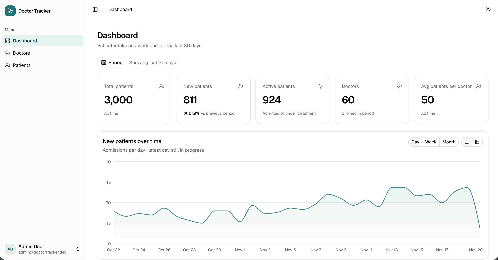
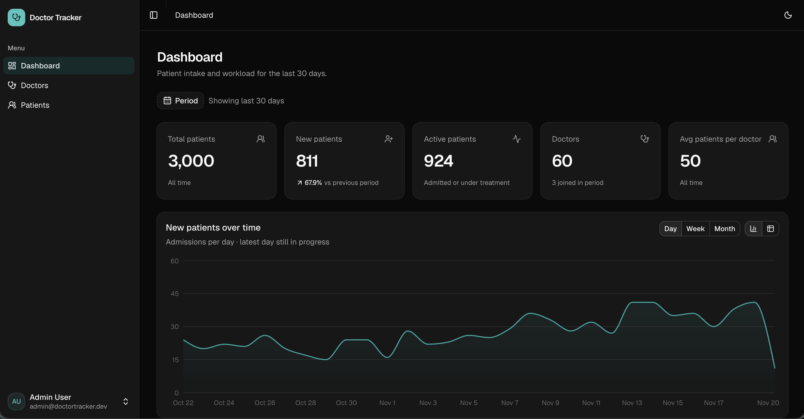
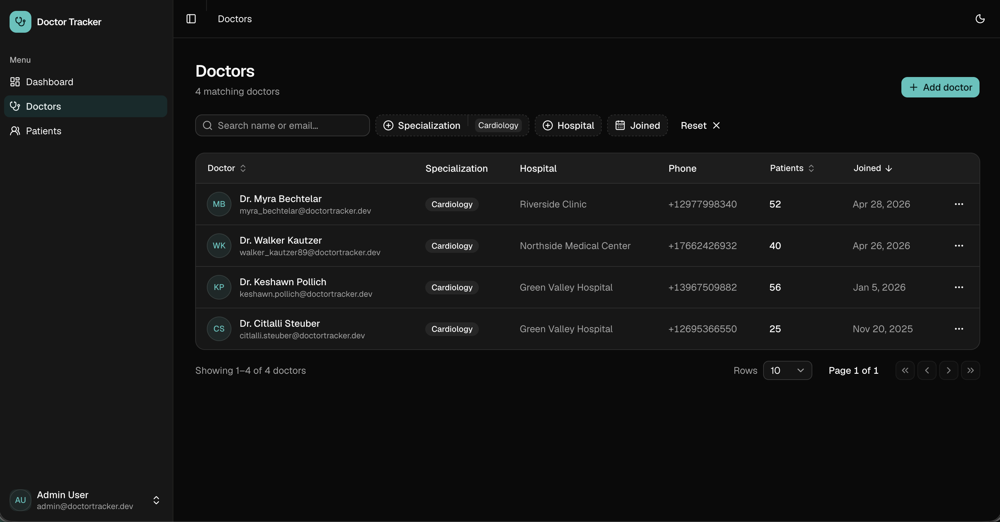
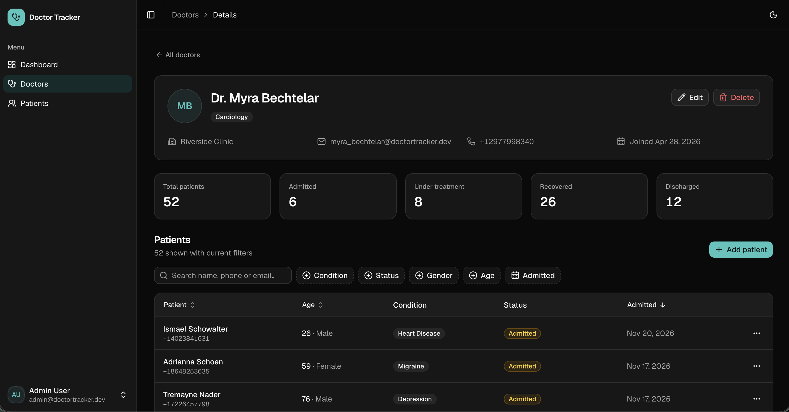
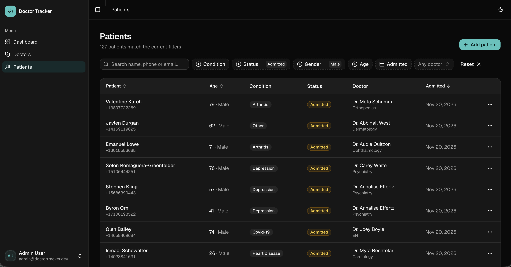
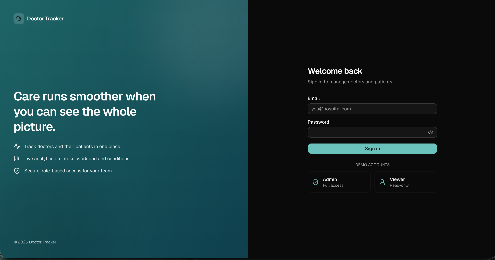
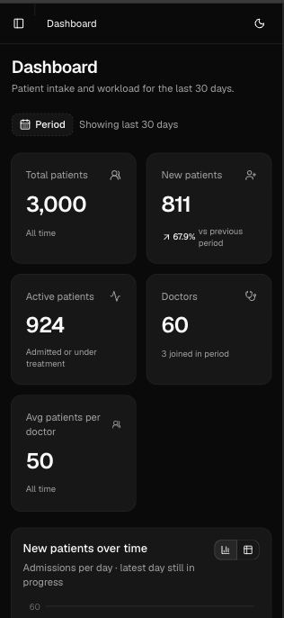
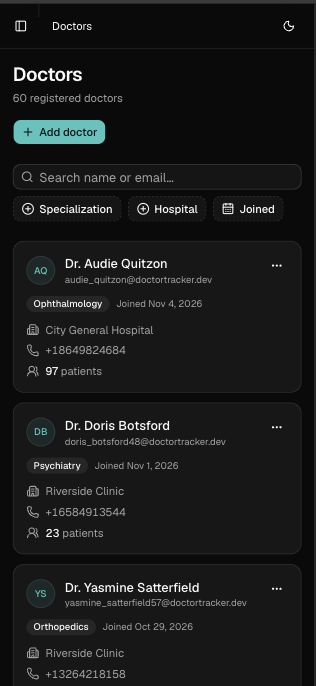
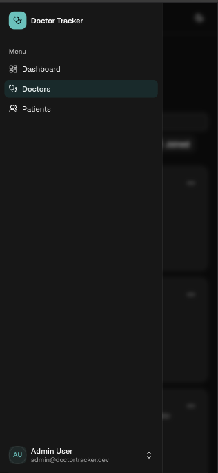
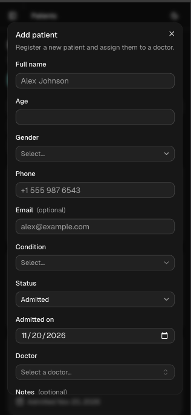

# Doctor Tracker — Client

> **Live app:** https://client-tawny-five-79.vercel.app
> **API repo:** https://github.com/TanyeemSafwan/server · **API:** https://server-kl2l.onrender.com/api/v1/health
>
> Demo login credentials (an admin account and a read-only viewer account) are included in the submission email.
>
> The API runs on Render's free tier, so the **first request after a period of inactivity can take 30–50 seconds** while the server wakes up. After that it's fast.

## Description

Doctor Tracker is a secure admin portal for clinics to manage doctors and the patients under their care. Admins can register doctors, add and manage patients, and find any record instantly with index-backed search, filters and pagination, all kept in the URL so every view can be shared or bookmarked. An analytics dashboard turns the data into insights: patient intake over time, the busiest doctors, condition and status breakdowns, and team composition. It's responsive from phone to desktop and supports light and dark mode. Access is protected with httpOnly-cookie authentication and role-based permissions (admin vs. read-only viewer).

This repository is the **Next.js frontend**. The REST API lives in a separate repository: [TanyeemSafwan/server](https://github.com/TanyeemSafwan/server).

## Features

- **Authentication**: login with httpOnly JWT cookie, every page protected, session-expiry handling, demo accounts
- **Authorization**: admin vs. viewer roles; write actions hidden in the UI for viewers and rejected (403) by the API
- **Doctors**: create, edit, delete (blocked while they still have patients), search, filter by specialization / hospital / joined date, sort, paginate
- **Doctor details**: profile, patient status summary, the doctor's own patient list with add / edit / delete
- **Patients**: list, search (name, phone, email), filter by condition, status, gender, age group, admission date and doctor, edit (including reassigning the doctor), delete
- **Dashboard**: KPI tiles with period-over-period change, intake trend (day / week / month), busiest doctors, patient mix by status and gender, conditions, doctors by specialization; click a bar to drill into the matching list; every chart has a table view
- **UX**: responsive layout with mobile cards and slide-out navigation, dark mode, skeleton loaders, empty / no-results / error states with retry, toasts, confirm dialogs, optimistic deletes, inline form validation (including server errors such as duplicate emails)

## Screenshots

### Desktop

| Dashboard | Dashboard (dark) |
|---|---|
|  |  |
| **Doctors (filtered)** | **Doctor details** |
|  |  |
| **Patients (filtered)** | **Login** |
|  |  |

### Mobile

| Dashboard | Doctors | Navigation | Add patient |
|---|---|---|---|
|  |  |  |  |

## Tech stack

| | |
|---|---|
| Framework | **Next.js 16** (App Router, Cache Components, React Compiler), **React 19**, TypeScript (strict) |
| UI | Tailwind CSS v4, shadcn/ui (Radix), lucide icons, next-themes, sonner |
| Server state | TanStack Query v5 |
| URL state | nuqs (filters, search, sort, pagination) |
| Tables | TanStack Table v8 |
| Forms | React Hook Form + Zod |
| Charts | Recharts (via shadcn chart), code-split with `next/dynamic` |
| Auth guard | `jose` (JWT verification in `proxy.ts`) |
| Hosting | Vercel |

## Setup guide

**Prerequisites:** Node.js 22+, and the [API](https://github.com/TanyeemSafwan/server) running locally (it needs MongoDB; see its README).

```bash
# 1. Clone both repos side by side
git clone https://github.com/TanyeemSafwan/server.git
git clone https://github.com/TanyeemSafwan/client.git

# 2. Start the API first (see server/README.md): install, .env, seed, npm run dev → http://localhost:4000

# 3. Client
cd client
npm install
cp .env.example .env.local
```

Edit `.env.local`:

| Variable | Value |
|---|---|
| `API_URL` | `http://localhost:4000` (the Express API) |
| `JWT_SECRET` | **exactly the same value** as the server's `JWT_SECRET` |
| `COOKIE_NAME` | `dt_token` (same as the server) |

These are server-side only (used by the rewrite and `proxy.ts`), never exposed to the browser.

```bash
npm run dev          # http://localhost:3001
```

Log in with the demo accounts created by the server's seed script (the `SEED_*` values in the server's `.env`).

| Script | |
|---|---|
| `npm run dev` | Dev server on port 3001 |
| `npm run build` / `npm start` | Production build / serve |
| `npm run lint` · `npm run typecheck` | ESLint · TypeScript |

## System architecture

```
                 ┌───────────────────────────── Vercel ─────────────────────────────┐
  Browser        │  Next.js app                                                      │
 ┌──────────┐    │   proxy.ts ── verifies the JWT cookie before rendering any page,  │
 │ React UI │───►│               redirects to /login?next=… if missing/expired       │
 │ TanStack │    │   next.config rewrites:  /api/*  ──────────────┐                  │
 │ Query    │    └────────────────────────────────────────────────┼──────────────────┘
 │ nuqs URL │  fetch("/api/v1/…")  (same origin, cookie sent)     │ HTTPS
 └──────────┘                                                     ▼
                 ┌───────────────────────────── Render ─────────────────────────────┐
                 │  Express 5 REST API                                               │
                 │  helmet → cors → json → cookies → rate limit → routes             │
                 │  → authenticate → authorize(permission) → validate(zod)          │
                 │  → controller → service (indexed queries / aggregations)          │
                 └───────────────────────────────┬──────────────────────────────────┘
                                                 ▼
                                    MongoDB Atlas (users, doctors, patients)
```

**Data flow for a typical interaction** (e.g. filtering patients):

1. The user picks a filter or types in the search box (debounced 300 ms). nuqs writes it to the URL: `?condition=Diabetes&page=1`.
2. `usePatients(filters)` uses the filters as its query key, so TanStack Query fetches `GET /api/v1/patients?…`, or serves it from cache if it was fetched recently.
3. The request goes to the Next.js origin and the rewrite forwards it to Express. The browser never talks to the API domain directly.
4. Express checks the cookie, the role's permission and the query parameters, then runs an index-backed MongoDB query and returns `{ data, meta }`.
5. While the next page loads, the previous rows stay on screen (dimmed) instead of flashing to a skeleton.
6. Mutations (create / edit / delete) invalidate the related queries (patients, doctors' counts, dashboard), so every screen stays consistent. Deletes are optimistic and roll back if the server refuses.

### Project structure

```
src/
├── app/                      # routes only (thin)
│   ├── (auth)/login/         # public
│   └── (app)/                # protected shell: sidebar + topbar
│       ├── dashboard/  doctors/  doctors/[id]/  patients/
│       ├── loading.tsx  error.tsx
├── proxy.ts                  # page guard (JWT check, redirects)
├── features/                 # one folder per domain: api.ts, hooks.ts, schemas.ts, components
│   ├── auth/  doctors/  patients/  dashboard/
├── components/
│   ├── ui/                   # shadcn primitives
│   ├── data-table/           # reusable server-side table kit (table, pagination, filters, search)
│   ├── charts/               # chart card, KPI tile, trend, bar list, stacked share bar
│   ├── layout/  shared/      # app shell, empty/error states, confirm dialog, <Can> gate
├── lib/                      # api client, query client + keys, URL parsers, formatting
├── constants/  types/  hooks/
```

## Technical decisions

### 1. Same-origin API proxy + httpOnly cookie, instead of tokens in localStorage

**Context.** The spec requires a separate Next.js client and Express server. They run on different domains (`*.vercel.app` and `*.onrender.com`), and every page must be protected.

**Options considered.**
- **JWT in localStorage + `Authorization` header.** Simple, but any XSS can read the token. The server can't protect pages either, because the token isn't sent on navigation, so protected content would flash before a client-side redirect.
- **httpOnly cookie set directly by the API domain.** The browser treats it as a *third-party* cookie, which requires `SameSite=None` and is increasingly blocked (Safari ITP, Chrome's third-party cookie restrictions). It also needs CORS preflights on every request.
- **Same-origin proxy (chosen).** `next.config.ts` rewrites `/api/*` to the Express server. The browser only ever talks to the Vercel domain, so the cookie the API sets is **first-party**.

**Decision and consequences.**
- The token lives in an `HttpOnly; Secure; SameSite=Lax` cookie that JavaScript can't read, which closes off XSS token theft. `SameSite=Lax`, the JSON-only API and same-origin requests cover CSRF.
- `proxy.ts` can read that same cookie and verify the JWT signature and expiry (`jose`) **before** a protected page renders, so there's no flash of protected content and `?next=` sends the user back where they were.
- The browser makes no CORS preflights, and the API stays a fully standalone REST service. You can still call it directly; it enforces auth on every route.
- **Trade-offs:** requests take one extra hop through Vercel, and the client and server must share `JWT_SECRET`. `proxy.ts` only does a fast, optimistic check (no database call); the API remains the authority on every request.

### 2. TanStack Query + URL state (nuqs) instead of Redux / Context

**Context.** Almost all of this app's state is *server data* (doctors, patients, stats) plus *view state* (filters, search, sort, page). The spec asks for proper state management and data fetching, and for avoiding unnecessary re-renders.

**Options considered.**
- **Redux Toolkit (+ RTK Query).** Capable, but adds a global store, slices and boilerplate for state that is really either server cache or URL parameters.
- **React Context + `useEffect` fetching.** Every consumer re-renders on any change, and caching, deduplication, request cancellation, retries and loading/error states would all have to be written by hand.
- **TanStack Query for server state + nuqs for URL state (chosen).**

**Decision and consequences.**
- **Server state → TanStack Query.** Gives caching, request deduplication, cancellation of outdated requests (`AbortSignal`), background refetch and stale times. `keepPreviousData` keeps the current page visible while the next one loads. Mutations invalidate exactly the related keys via a central key factory (`lib/query-keys.ts`), and deletes are optimistic with rollback.
- **View state → the URL (nuqs).** Filters, search, sort and page are typed URL parameters. Views are shareable and bookmarkable, the back button restores previous filters, a refresh keeps everything, and dashboard drill-downs are just links (`/patients?condition=Flu&from=…`). Each filter component subscribes only to its own parameter.
- **What remains is local**: form state (React Hook Form) and dialog open/close (`useState`). There's no global store to keep in sync, and the React Compiler handles memoization automatically.
- **Trade-offs:** URL parameters need parsing and validation (nuqs parsers, including a custom local-date parser so dates don't shift across timezones). Under Next.js Cache Components, any component reading search params needs a `<Suspense>` boundary.

## Performance

- Server-side pagination, filtering and sorting; the client only ever holds one page of results
- Debounced search (300 ms); outdated requests are cancelled
- The React Compiler memoizes automatically; TanStack Table, the one incompatible library, is isolated in a single component
- Recharts is code-split (`next/dynamic`) and loaded only on the dashboard
- Previous data stays visible during refetches (no layout jumps); every dashboard widget loads independently
- Static app shell with streamed content (Cache Components + Suspense); `next/font` with no layout shift
- Chart colors chosen for colorblind-safe separation and contrast in both themes; every chart also has a table view

## Accessibility

Keyboard-accessible Radix primitives, a skip-to-content link, labelled icon buttons, `aria-invalid` and inline error text on form fields, `aria-live` pagination summary, status shown as text + color (never color alone), and table views for every chart.

## Future improvements

Refresh-token rotation · password reset · role management UI · cursor-based pagination for very large lists · end-to-end tests (Playwright) · CSV export · audit log of changes

---

Built by **Tanyeem As Safwan**.
